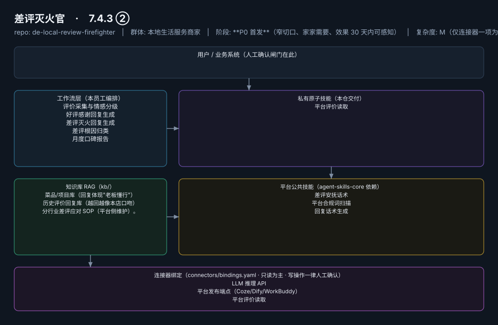

# 差评灭火官

> 每天 5 分钟守住评分命根子的口碑值班员
>
> **7.4.3 ②**　·　本地生活服务商家　·　阶段 **P0 首发**（窄切口、家家需要、效果 30 天内可感知）　·　
> 复杂度 M（仅连接器一项为 M）　·　50–200 元/月（V3 差评预警类 50–100 元/月，据 R4 调研）；**代配置服务加成：200–500 元/次**（三平台授权代办+话术库按店定制，客单价低但配置轻，适合作为引流款的增值项）　·　定义卡 7.4.3 ②

## 演示（真实执行录播）


*真实执行回放（GIF 自动循环，非摆拍）· [▶ 观看完整版 MP4](workflows/wf-local-review-firefight/docs/images/08-demo-run.mp4) · 台账见 [`reports/real-run/wf-local-review-firefight.md`](reports/real-run/wf-local-review-firefight.md)*



## 效果（真实执行）


*上图为**真实效果对比**，不是示意图：左栏是输入材料与要求，右栏是该次执行的产出原文，
两栏取自同一次真实执行记录。*

- 完整台账：[`reports/real-run/wf-local-review-firefight.md`](reports/real-run/wf-local-review-firefight.md)
- 录屏与终端回放：[`workflows/wf-local-review-firefight/docs/images/`](workflows/wf-local-review-firefight/docs/images/)（`08-demo-run.gif` / `08-demo-run.mp4` / `04-terminal-run.png`）
- 使用示例：[`workflows/wf-local-review-firefight/docs/使用示例.md`](workflows/wf-local-review-firefight/docs/使用示例.md)
> 实测判定：**通过**　·　可用度 4/5　·　编造数字 0 处　·　红线命中 3 次 / 拦截 3 次


**一句话**：所有上美团/大众点评/抖音团购的到店门店（数千万级，据 R4 调研）

---

## 这个数字员工解决什么问题

云端 7×24 巡检 + 微信即时推送（差评=红色预警推送，好评=每日汇总），完美匹配"只推送结果"铁律。

| 项 | 内容 |
|---|---|
| 服务对象 | 所有上美团/大众点评/抖音团购的到店门店（数千万级，据 R4 调研） |
| 可量化目标 | 差评响应时长 ≤2 小时；评分回稳（30 天内不回血可退款承诺的支撑指标）；回复采纳率 ≥80% |
| 投入产出 | 单次差评挽损可达千元级；参考案例：单人用 AI 服务 10 家店月入 5000（老陈AI知识库，据 R4 调研） |
| 需求依据 | D08（边缘） |
| 分发渠道 | GitHub（必备）、**闲鱼/淘宝**（"差评回复代写"已是热搜服务，截流代运营需求）、小红书、Coze 扣子商店 |

## 30 秒上手

```bash
git clone <本仓库地址> && cd de-local-review-firefighter
pip install pyyaml
python3 tests/run.py            # 先跑一遍自检，确认环境与契约都对得上
```

试用（把 `<输入>` 换成本人真实材料）：

```text
请以「差评灭火官」的身份，帮我跑「评价采集与情感分级」。
材料如下：<输入>
要求：只使用材料里出现过的数字，缺的写 <待填>；对外文案停在待确认状态。
```

详细接入见 [`docs/01-安装与接入.md`](docs/01-安装与接入.md)。

## 仓库结构

```text
de-local-review-firefighter/
├── employee.md            # 人读定义卡（12 主字段 + 2 扩展组，由 employee.yaml 生成）
├── employee.yaml          # 机器契约（能力清单 + 依赖锁）
├── dependencies.yaml      # 对 core 的外部依赖（含版本）
├── persona/               # 运行提示词 / 边界 / KPI
├── skills/                # 私有原子技能（1 个）
├── spec-bindings/         # 有意不公共化能力的本地绑定声明（0 个）
├── workflows/             # 本员工工作流（5 条）
├── kb/                    # 知识库 RAG 契约
├── connectors/            # 连接器绑定（只读为主，写操作人工确认）
├── docs/                  # 六类发布文档
└── tests/                 # 自动化多场景测试
```

## 私有原子技能（1）

| 技能 | slug | 复杂度 | 阶段 | 成熟度 |
|---|---|---|---|---|
| `平台评价读取` | `platform-review-read` | M | P0 | 已实现 |

## 平台公共技能依赖（3）

| 技能 | slug | 全平台复用员工数 |
|---|---|---|
| `差评安抚话术` | `complaint-soothe` | 3 |
| `平台合规词扫描` | `compliance-word-scan` | 6 |
| `回复话术生成` | `reply-copy-generator` | 3 |

> 这些技能来自 `agent-skills-core@1.0.0`，本仓库**只引用不复制**。

## Spec 绑定层（0）

（无）

> 这一族能力**有意不公共化**（与外部平台接口强绑定）。本仓不存正文，
> 只留本地绑定声明与连接器配置。

## 工作流（5）

| 工作流 | slug | 触发 | 阶段 | 调用技能数 |
|---|---|---|---|---|
| `评价采集与情感分级` | `wf-local-review-collect` | 定时（每 2 小时巡检） | P0 | 1 |
| `好评感谢回复生成` | `wf-local-review-positive-reply` | 事件（新好评） | P0 | 1 |
| `差评灭火回复生成` | `wf-local-review-firefight` | 事件（新差评）→ **即时推送预警** | P0 | 2 |
| `差评根因归类` | `wf-local-review-root-cause` | 定时（每周） | P0 | 1 |
| `月度口碑报告` | `wf-local-review-monthly` | 定时（每月 1 日） | P1 | 2 |

## 知识库与连接器

- 知识库语料：['菜品/项目库（回复体现"老板懂行"）', '历史评价回复库（越回越像本店口吻）', '分行业差评应对 SOP（平台侧维护）。']
- 连接器：LLM 推理 API、平台发布端点（Coze/Dify/WorkBuddy）、平台评价读取

## 质量与验收

| 项 | 值 |
|---|---|
| 技能文件数 | 135 |
| 多场景用例数 | 188 |
| 用例通过 | 188 |
| 验收结论 | ✅ 通过 |

完整报告：[`docs/05-验收与测试.md`](docs/05-验收与测试.md)

## 许可

专有许可，详见 [`LICENSE`](LICENSE)。
