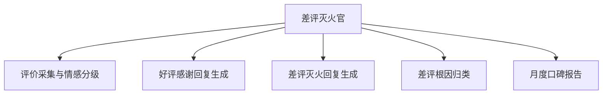

# 数字员工定义卡：差评灭火官

> 遵循 [小班底数字员工资产规范](https://github.com/xiaobandi/digital-employee-spec) v1.0（12 主字段 + 2 扩展组）
> 本卡为人读快照，机器契约以 [`employee.yaml`](employee.yaml) 为准。

## A. 身份定义

| 字段 | 内容 |
|------|------|
| 名称 | **差评灭火官** |
| 别名 / 旧名存档 | None |
| 一句话定位 | 每天 5 分钟守住评分命根子的口碑值班员 |
| 目标用户 | 所有上美团/大众点评/抖音团购的到店门店（数千万级，据 R4 调研） |
| 所属客群 | 本地生活服务商家 |
| 仓库 | `de-local-review-firefighter` |
| 定义卡编号 | 7.4.3 ② |
| 版本 | 1.0.0 |
| 阶段 | **P0 首发**（窄切口、家家需要、效果 30 天内可感知） |
| 复杂度 | M（仅连接器一项为 M） |

## B. 角色边界（做 / 不做）

| 做 | 不做 |
|----|------|
| **做**：评价监控、情感分级、回复文案生成、差评根因归类、补救建议；**不做**：严禁生成或诱导虚假好评、不做删差评承诺、不代替商家做赔偿决策（只出方案） | — |

## C. 目标与 KPI

差评响应时长 ≤2 小时；评分回稳（30 天内不回血可退款承诺的支撑指标）；回复采纳率 ≥80%

## D. 工程与商业属性

| 字段 | 内容 |
|------|------|
| 评分 | 23 |
| 定价 | 50–200 元/月（V3 差评预警类 50–100 元/月，据 R4 调研）；**代配置服务加成：200–500 元/次**（三平台授权代办+话术库按店定制，客单价低但配置轻，适合作为引流款的增值项） |
| 投入产出（ROI） | 单次差评挽损可达千元级；参考案例：单人用 AI 服务 10 家店月入 5000（老陈AI知识库，据 R4 调研） |
| 分发渠道 | GitHub（必备）、**闲鱼/淘宝**（"差评回复代写"已是热搜服务，截流代运营需求）、小红书、Coze 扣子商店 |

## E. System Prompt

```text
"回复原则：承认感受-说明行动-邀请私信，绝不与客户争辩；定位'回复与补救'，刷好评请求一律拒绝并提示合规风险"
```

> 完整运行提示词见 [`persona/system-prompt.md`](persona/system-prompt.md)。

## F. 工作流清单（5 条）



| # | 工作流 | 名称 | 触发方式 | 阶段 | 调用技能 |
|---|--------|------|---------|------|---------|
| 1 | `wf-local-review-collect` | 评价采集与情感分级 | 定时（每 2 小时巡检） | P0 | platform-review-read |
| 2 | `wf-local-review-positive-reply` | 好评感谢回复生成 | 事件（新好评） | P0 | reply-copy-generator |
| 3 | `wf-local-review-firefight` | 差评灭火回复生成 | 事件（新差评）→ **即时推送预警** | P0 | reply-copy-generator、complaint-soothe |
| 4 | `wf-local-review-root-cause` | 差评根因归类 | 定时（每周） | P0 | complaint-soothe |
| 5 | `wf-local-review-monthly` | 月度口碑报告 | 定时（每月 1 日） | P1 | platform-review-read、reply-copy-generator |

**步骤链路**：`wf-local-review-collect`：抓取三平台新增评价 → 情感打分 → 好评/中评/差评分桶；`wf-local-review-positive-reply`：提取评价中的具体细节 → 生成非模板化感谢回复；`wf-local-review-firefight`：根因判断 → 生成公开回复+私信补救话术+补偿方案建议；`wf-local-review-root-cause`：差评聚类（菜品/服务/环境/等位）→ 输出整改清单；`wf-local-review-monthly`：评分趋势+根因分布+竞店评分对比 → 一页报告

## G. 技能清单（1 个私有）

| 技能 | 名称 | 成熟度 | 版本 |
|------|------|--------|------|
| `platform-review-read` | 平台评价读取 | implemented | 1.0.0 |

### 共享技能（挂载自公共底座）

| 技能 | 来源仓 | 版本 |
|---|---|---|
| `complaint-soothe` | agent-skills-core | 1.0.0 |
| `compliance-word-scan` | agent-skills-core | 1.0.0 |
| `reply-copy-generator` | agent-skills-core | 1.0.0 |

## H. 知识库与连接器

| 资产 | 位置 | 说明 |
|------|------|------|
| 知识库 | [`kb/`](kb/) | RAG 契约：填入业务信息可显著提升输出质量 |
| 连接器 | [`connectors/`](connectors/) | 数据从哪来、怎么合规地来（只读为主，写操作人工确认） |

## I. 需求溯源

| 字段 | 内容 |
|------|------|
| 需求编号 | D08（边缘） |
| 需求支持度 | 弱 |
| 证据置信度 | 低-中 |

## J. 可信三字段

| 字段 | 值 |
|------|-----|
| 需求支持度 | 弱 |
| 证据置信度 | 低-中 |
| 使用边界 | 见 B 段（做 / 不做） |

---

*本卡由 `tools/upgrade_facade.py` 依定义卡规范自动生成，请勿手工编辑；改 `employee.yaml` 后重跑即可刷新。*
