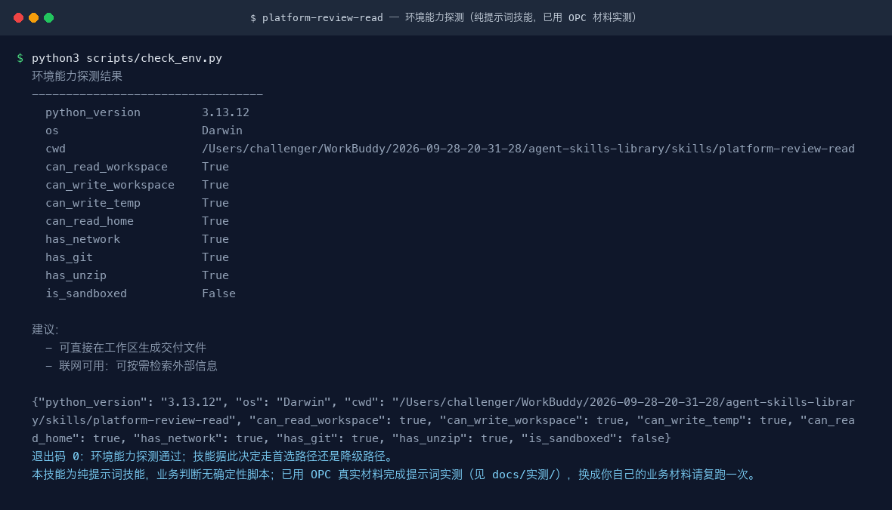
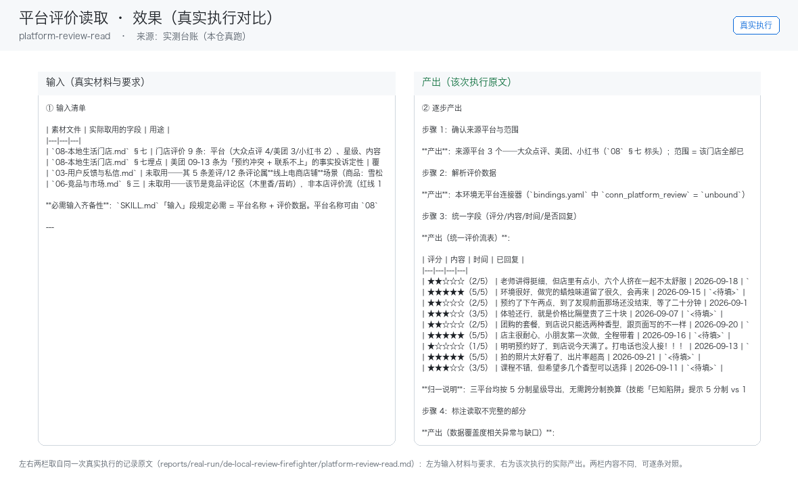

# 平台评价读取

> 从本地生活平台读取评价流并统一格式化，供差评灭火与评价分析使用
>
> L1 原子技能　·　复杂度 M　·　阶段 P0　·　可见性 private　·　版本 v1.0.0



*环境能力探测（真实运行）。本技能为纯提示词技能，无可执行业务脚本——**真实效果示例待补**，补法与要求见 `docs/使用示例.md`。*

---

## 验收状态

本技能的验收口径见本仓 `docs/05-验收与测试.md`；测试用例见 `skills/platform-review-read/tests/cases.yaml`。

---

## 解决什么问题

> ⚠️ 本技能尚未填写真实痛点（`pain_points`），下表为**通用推导**，信息量有限。

| 现实痛点 | 本技能的做法 |
|---|---|
| 「从本地生活平台读取评价流并统一格式化」这件事靠人手工做，慢，而且每次结果不一样 | 固定成 5 步流程，同一份输入给出同一套结构，换人做也一致 |
| 新人不知道哪里会踩坑，重复交学费 | 已把 2 个**真实踩过的坑**写进文档，交付前逐条核对 |
| 交付物各写各的，团队没法横向比较 | 输出结构固定为「统一评价流表 + 覆盖度说明」，不随执行者漂移 |

---

## 快速开始

### 1. 安装（五平台通用）

本技能是**标准 Agent 技能**：目录名 == `name`、只使用标准字段、正文里没有任何平台专有工具名。因此同一份目录可以直接用于下列平台：

| 平台 | 安装方式 |
|---|---|
| WorkBuddy | 把技能目录放到 `~/.workbuddy/skills/`，或在对话里直接说触发词 |
| ChatGPT | 打包为 zip 后在 Skills 设置里上传（需支持 Skills 的版本） |
| DeepSeek Harness | `新建技能 安装:<repo-url>`，或把目录放进 harness 的 skills 目录 |
| Kimi Work | 上传 zip 或放置到技能目录；注意 Kimi Work 不会自动触发，需显式点名技能 |
| 豆包工作 | `新建技能 安装:<repo-url>`，或在技能管理处上传 zip |

```bash
# 通用做法：把本目录整体复制到目标平台的 skills 目录
cp -r platform-review-read <平台技能目录>/platform-review-read
```

### 2. 在你的 Agent 里调用

**方式一 · 自动触发**（description 里已写好中英触发词）：

```text
读取评价　平台评价　评价流　评价导出
```

**方式二 · 显式点名**（Kimi Work 不会自动调用，必须用这条）：

```text
用 platform-review-read 技能帮我处理：<你的材料>
```

### 3. 真实跑一次（本仓库最推荐的一步）

本技能为**纯提示词技能**，没有可执行脚本。验证方式是把技能装到目标平台后，用上面的触发词跑一次，并对照 `## 输出物长什么样` 的契约逐项检查。

```bash
# 平台兼容校验（本仓库对每个技能都跑过）；需在技能库根目录执行
python3 tests/run.py
```

---

## 输出物长什么样（真实产出）

> ⚠️ **本技能的真实效果示例尚未补齐。** 以下仅为输出结构契约，**不构成效果证据**。

```markdown
| 评分 | 内容 | 时间 | 已回复 |
## 数据覆盖度
```

---

## 适用场景与不适用场景

**适用**

- 需要**稳定输出结构**的场景：统一评价流表 + 覆盖度说明

**不适用（写清楚做不到什么，比列一堆能力更有用）**

- 不绕过平台反爬与访问限制

---

## 已知陷阱（真实踩过的坑）

> 这一段比能力列表更有用：它们是从实际使用中撞出来的，交付前请逐条核对。

- 无连接器时绝不能凭印象编造评价，只能处理用户提供的文件
- 各平台评分标准不同（5 分制 vs 10 分制）需归一

---

## 常见问题

**Q：为什么没有脚本？**

本技能的判断依赖语境理解（读语气、读潜台词、读平台调性）。这类事写成规则只会更不可靠，所以交给模型执行，用输出契约约束质量、用交付前自检项兜住下限。

**Q：输出不稳定怎么办？**

先按这个顺序查：① 输入是否满足「必填」清单——缺料时应当停下来问而不是猜；② 是否走到了降级路径（有脚本的技能会在结尾说明用了哪条）；③ 对照「输出物长什么样」的结构逐项核对，缺项要求补齐而不是接受。

**Q：怎么改才能不破坏跨平台性？**

三条：目录名 == frontmatter 的 `name`；只使用标准字段（name / description / license / compatibility / metadata）；正文里不出现任何平台专有工具名，平台差异下沉到 `references/`。改完跑一次平台兼容校验。

---

## 目录结构

```text
platform-review-read/
├── SKILL.md                  # 技能定义（跨平台标准）
├── README.md
├── index.html                # 交付物导航页（浏览器打开）
├── site.json                 # 导航数据
├── docs/
│   ├── 使用手册.md / .html
│   ├── 使用示例.md / .html
│   ├── 用户场景.md / .html
│   ├── 架构与流程图.md / .html
│   └── images/               # 架构图 / 流程图 / 决策矩阵 / 终端截图 / 录屏
├── references/
│   └── architecture.md       # 字段、脚本、依赖速查
├── examples/
│   ├── input/                # 真实运行夹具
│   └── output/               # 真实抓取的命令输出
├── demo/
│   └── walkthrough.html      # 演示页（真实会话回放）
```

---

## 合规与边界

- 许可：MIT；版本 v1.0.0
- 归属：de_local_review_firefighter
- 输出内容在对外发布前，**必须**按《广告法》与目标平台规则逐条人工复核
- 本技能不做平台官方审核的替代，只做发布前自查

---

## 深入了解

| 文档 | 用途 |
|---|---|
| `docs/使用手册.md` | 安装、参数总表、输出物说明、排错手册 |
| `docs/使用示例.md` | 可直接复制的示例，含真实运行输出节选 |
| `docs/用户场景.md` | 谁、什么时机、说什么、得到什么、注意什么 |
| `docs/架构与流程图.md` | 业务架构、执行流程、脚本与模型分工、扩展指南 |
| `references/architecture.md` | 字段、脚本、上下游依赖速查 |
| `SKILL.md` | 技能定义（触发词、能力边界、使用方式） |
| `demo/walkthrough.html` | 演示页：真实会话回放 |

演示录屏：`docs/images/08-demo-run.gif`（动图）· `docs/images/08-demo-run.mp4`（视频）
效果图：`docs/images/04-terminal-run.png`（环境能力探测）

<!-- media-wired -->

## 效果与证据（真实执行）



左栏是输入材料与要求，右栏是该次执行的产出原文——两栏取自同一次真实执行，不是示意图。
完整台账见 [`docs/实测记录.md`](docs/实测记录.md)（输入清单 / 逐步产出 / 质量检查 / 如实说明），
构建区原件为 `reports/real-run/de-local-review-firefighter/platform-review-read.md`。
终端回放 [`docs/images/04-terminal-run.png`](docs/images/04-terminal-run.png)；
录屏 [`docs/images/08-demo-run.gif`](docs/images/08-demo-run.gif)　·　
[`docs/images/08-demo-run.mp4`](docs/images/08-demo-run.mp4)
（`发布标准.md` 第 8 项要求 GIF + MP4，有实测记录的单元一律生成）。

## 文档索引

| 文档 | 用途 |
|---|---|
| [`SKILL.md`](SKILL.md) | 机器契约：触发条件、输入、执行步骤、输出格式、边界 |
| [`docs/使用手册.md`](docs/使用手册.md) | 安装、触发、输入契约、输出与常见问题 |
| [`docs/使用示例.md`](docs/使用示例.md) | 真实输入 → 输出，可照着复现 |
| [`docs/用户场景.md`](docs/用户场景.md) | 谁在什么时机用、拿到什么、注意什么 |
| [`docs/架构与流程图.md`](docs/架构与流程图.md) | 分层架构 + 流程图 + 每步的承担者（脚本/模型） |
| [`docs/实测记录.md`](docs/实测记录.md) | 真实执行台账（效果证据的出处） |
| [`demo/walkthrough.html`](demo/walkthrough.html) | 不装也能在线看 |
| [`index.html`](index.html) | 单元导航页 |
| [`tests/cases.yaml`](tests/cases.yaml) | 端到端 / 闸门 / 降级用例 |
<!-- /media-wired -->
